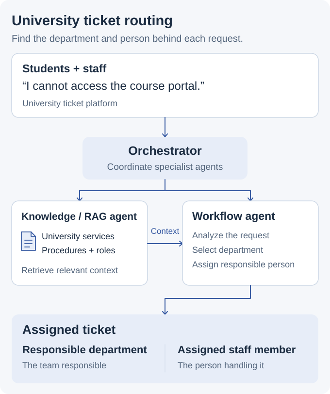

# University Multi-Agent Ticket Routing

> [!CAUTION]
> **University project.** This page describes the multi-agent system I built. Diagrams and example tickets explain its workflow; application source, deployment records and evaluation results are not published here.

## Get a university request to the right department and person

Students and staff submit requests through a university ticket platform. A login problem, an enrollment document, and an administrative question need different people to handle them. I built a multi-agent system for a university that connected those requests to university knowledge and the staff responsible for resolving them.

**My contribution:** I built a multi-agent system with an orchestrator, a university knowledge agent, and a workflow agent. I connected knowledge retrieval, request analysis, and ticket routing into one coordinated process.

**AI approach:** multi-agent orchestration · retrieval-augmented generation (RAG) · request analysis · workflow routing

<picture>
  <source media="(prefers-color-scheme: dark) and (max-width: 520px)" srcset="assets/university-ticket-story-v3-mobile-dark.svg">
  <source media="(max-width: 520px)" srcset="assets/university-ticket-story-v3-mobile-light.svg">
  <source media="(prefers-color-scheme: dark)" srcset="assets/university-ticket-story-v3-dark.svg">
  
</picture>

### How the agents worked together

| Component | What it did |
| --- | --- |
| Orchestrator | Coordinated the specialist agents processing a ticket. |
| University knowledge agent | Retrieved relevant university information to give the request context. This is retrieval-augmented generation, or RAG. |
| Workflow agent | Analyzed the request and routed the ticket to the department and person responsible for it. |

The useful result was an assigned ticket that someone could act on. The AI workflow connected understanding the request to taking the next step in the university's service process.

### A request in practice

| Request | Relevant context | Routing destination |
| --- | --- | --- |
| “I cannot access the course portal.” | Portal access guidance and support ownership. | IT support and the person responsible for portal access. |
| “I need an enrollment letter.” | Student-service procedures and document responsibilities. | Student services and the person handling enrollment documents. |
| “Who handles my leave request?” | Staff procedures and administrative responsibilities. | HR or staff administration and the responsible person. |

For the portal request, the orchestrator coordinated the agents, the knowledge agent retrieved university context, and the workflow agent used it to decide where the ticket belonged.

<strong>Engineering details: orchestration, retrieval, and routing</strong>

### Separate knowledge retrieval from the routing decision

The knowledge agent supplied context about university services. The workflow agent interpreted the request and selected a destination. I used the orchestrator to connect those responsibilities, rather than treating a generated answer as the end of the workflow.

### Information flow

1. A student or staff member submitted a ticket.
2. The orchestrator coordinated request processing.
3. The knowledge agent retrieved relevant university information.
4. The workflow agent analyzed the request with that context.
5. The ticket was routed to the responsible department and person.

### Why this matters for applied AI

The project used retrieved knowledge to support an operational decision: who should handle the request. It combined specialist agent responsibilities with a defined next step in the application.

[Back to my portfolio](https://github.com/MahdiHajjHassan)
